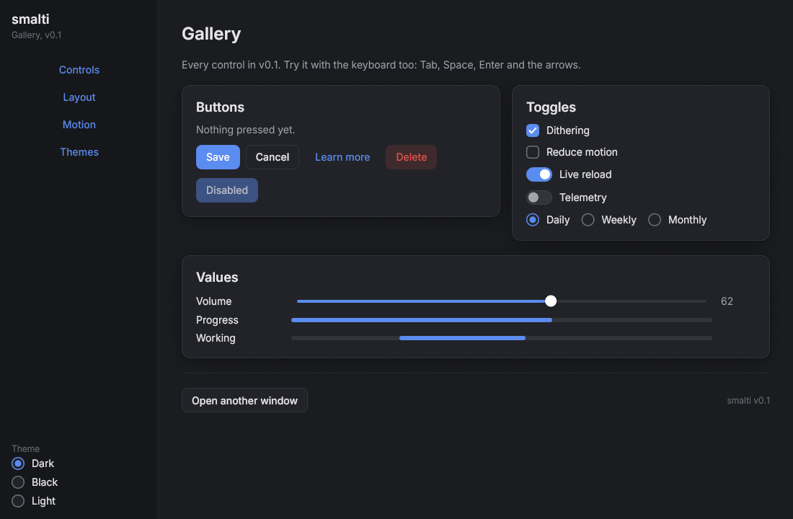
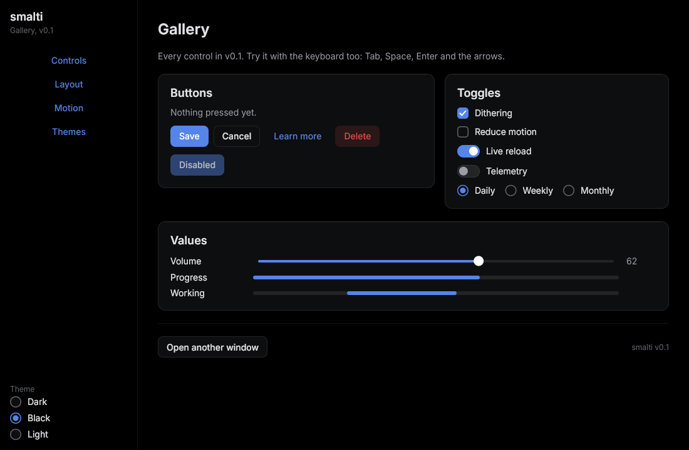
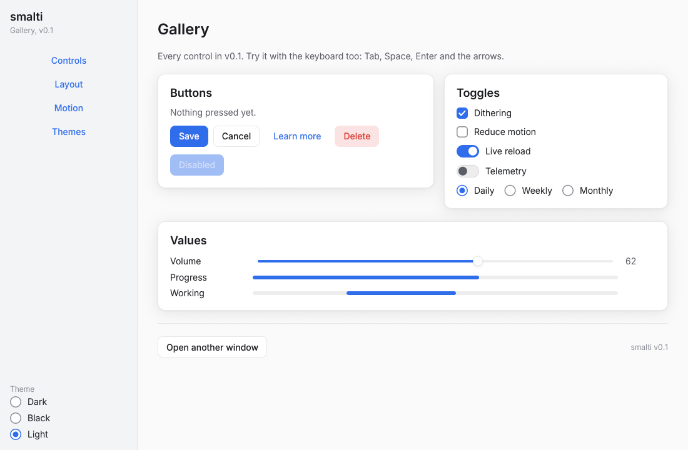

# What it looks like

The gallery example (`examples/gallery.cpp`), rendered without a screen by `tools/screenshots.py`, in the three built-in themes.

**Dark**, the default dark theme: very dark grey surfaces, kind to LCD screens.



**Black**, for OLED screens: the background is pure black, so those pixels are off. A shadow cannot be seen on black, so depth comes from slightly lighter surfaces, hairline borders and a faint top highlight.



**Light.**



## The code behind a window

```cpp
#include <smalti/smalti.hpp>
namespace sm = smalti;

int main() {
  sm::App app;
  auto win = app.open_window({"Settings", {420, 300}});
  auto col = win->add<sm::Column>(sm::StackOptions{.spacing = 12, .padding = sm::Insets::all(24)});
  col->add<sm::Label>("Settings", sm::LabelOptions{.role = sm::TextRole::heading});

  auto card = col->add<sm::Card>();
  card->add<sm::Switch>("Live reload", true);
  auto volume = card->add<sm::Slider>(sm::SliderOptions{.min = 0, .max = 100, .value = 40});
  auto readout = card->add<sm::Label>("40", sm::LabelOptions{.role = sm::TextRole::secondary});
  volume->on_change([readout](float v) { readout->set_text(std::to_string(static_cast<int>(v))); });

  auto actions = col->add<sm::Row>(sm::StackOptions{.spacing = 8, .justify = sm::Align::end});
  actions->add<sm::Button>("Cancel")->on_click([win] { win->close(); });
  actions->add<sm::Button>("Save", sm::ButtonVariant::primary)->on_click([win] { win->close(); });
  return app.run();
}
```

- Widgets are created by their parent with `add<T>()`, which returns a `Ref<T>`.
- Options are plain structs with designated initialisers, so every setting is named at the call site.
- Callbacks capture `Ref`s by value. A `Ref` whose widget is gone is a reported error, never a crash in freed memory.
- `app.run()` returns when the last window closes.
